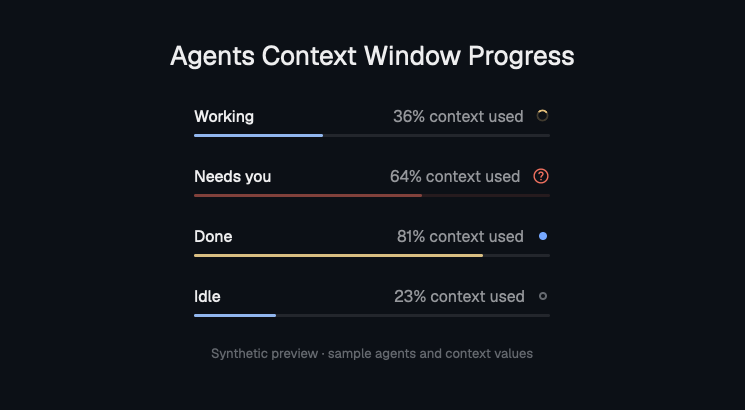

# Agents Context Window Progress

A modified Herdr Agents panel with thin context-usage bars, a moving highlight for working agents and a pulsing bar plus question-mark icon when input is needed.



Requires Herdr App 0.1.15 and `hc` on PATH. Install from the repository root:

```sh
python3 install.py agents-context-window-progress --layout my-agents
python3 install.py agents-context-window-progress --layout my-agents --apply
```

Context measurements currently support the Codex terminal footer only. Every 15 seconds the mod reads visible screens with `hc read --lines 0`; only the last four lines are considered. A `77% context left` footer becomes **23% used**. Other agents or an unreadable footer get a neutral track, never a fabricated percentage. Samples expire after 60 seconds. No terminal history, input, model calls or persisted transcripts are used.

| Agent state | Bar and indicator |
|---|---|
| Working | Soft moving highlight clipped to measured usage; a neutral animated track when context is unavailable |
| Needs input | Theme's blocked color, gentle 2.2-second pulse, circled question mark with “Needs your input” tooltip |
| Done / Idle | Static context bar and the normal dot/ring status marker |

The bar still measures context, not task completion. At 70%/90% used it turns amber/red; the input-needed color takes priority. Motion uses native GPUI loops and stops when not drawn. Grouping, pins, sub-agents and focus behavior are inherited from Herdr's Agents panel. A parent's group can reflect a blocked child, while each row's animation reflects that row's own state.

Optional commands for your own unused keybindings: `agents-context.next-idle`, `agents-context.next-completed`, `agents-context.next-working`. They follow the panel's agent order and wrap around. No keys are overwritten by this package.

Validation: `node --test agents-context-window-progress/tests/*.test.mjs`. The synthetic preview uses real rendering methods with sample values. Native captures verified changing frames for the moving highlight and input pulse.
