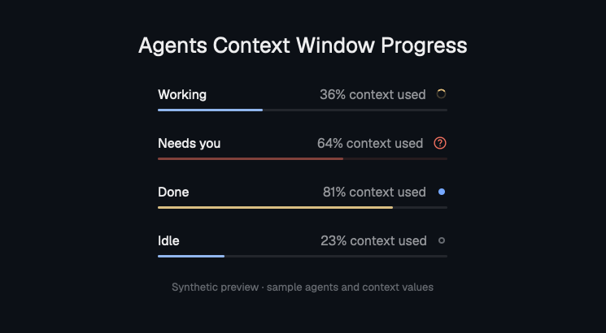

# Agents Context Window Progress

The normal Agents panel, with a 3 px context bar under each agent and sub-agent, retaining its compact rows and native theme.

## What you see

Agents header with sorting menu, priority or space groups, parent rows and indented sub-agents. Context bars sit 2 px below each row, inset 8 px (39 px for sub-agents), with 4 px bottom spacing. Below 70% used they use the accent color, then amber, then red at 90%. Input-needed rows use the theme's blocked color and a circled question mark instead of a text badge.

## How it behaves

Working rows have a soft 40 px highlight moving within the fill on a native 3.6-second round trip. Input-needed rows stop that highlight and gently pulse opacity from 0.45 to 1 on a 2.2-second cycle. Done/idle bars stay still; their status icons remain a dot/ring. Unavailable context keeps a neutral track (with activity motion where appropriate), not 0%. Tooltips explain used/free percentages or unavailable context. Row clicks focus the agent; pins, grouping, collapsing and sub-agent peeks retain Herdr behavior.

## Built from

`mods/agents-context` is a clone of Herdr's `agents` mod at 0.1.15. Copy that folder without overwriting an existing one, clone the layout, then change only the `agents` block's `content.mod` to `agents-context`. Keep its existing size and position. It uses Herdr's installed workspace-chrome icons plus the included `needs-input.svg`.

The extension reads `terminals`, `agents`, `focused` and the standard layout data; `exec("hc", ["read","--lines","0",address])` reads visible Codex screens in batches of four, every 15 seconds, with a 4-second timeout. Footer parsing is confined to the last four lines after ANSI removal. Native `.loop` and layout measurements animate without JavaScript redraw timers. State/focus/pin commands and optional next-status navigation reuse Herdr's APIs.

## Watch out

Never infer questions by scanning conversation text: use blocked/error status reported by Core. Context is consumed capacity, not task progress. Do not scan earlier terminal output for percentage-like text. Only Codex footers are supported; other formats must remain unavailable until separately implemented. Parent urgency and the parent's own status are different. Samples expire after 60 seconds. Every child question-mark tooltip needs its own element ID.

## Done when

Native checks pass, and the panel remains usable with no agents and with sub-agents. Footer tests accept both Codex formats and reject conversation percentages/out-of-range values. Working frames show changing highlight positions; blocked frames show varying opacity; done/idle stay static. The question mark replaces the input-needed row badge. Status navigation follows the sidebar order without sending terminal input.
