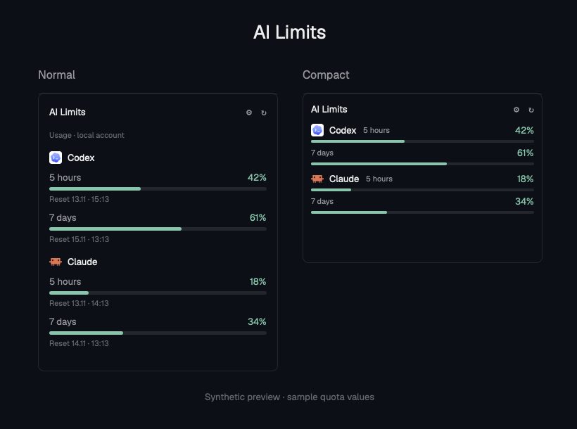

# AI Limits

Quota usage for installed agents, with compact/normal layouts selected in the widget's settings.



Requires Herdr App 0.1.15 and Python 3 (standard library only). Install from the repository root:

```sh
python3 install.py ai-limits --layout my-limits
python3 install.py ai-limits --layout my-limits --apply
```

Agents are discovered through Herdr. Antigravity additionally detects `agy` on PATH or in the Antigravity/Gemini macOS app bundle; `ANTIGRAVITY_CLI_PATH` is an authoritative override. Settings let you hide individual providers. Disabled providers are not queried. Detection is local, even while viewing a remote workspace.

| Provider | Quota source | Requirements |
|---|---|---|
| Codex | ChatGPT usage endpoint | Existing subscription OAuth session in `CODEX_HOME/auth.json` or `~/.codex/auth.json` |
| Claude | Claude Code OAuth usage endpoint | Existing credentials file or macOS `Claude Code-credentials` Keychain entry |
| Gemini | Code Assist load/quota endpoints | Gemini CLI Google OAuth login; API-key/Vertex modes are not supported |
| Antigravity | `agy -p /usage --output-format json` | Signed-in agy ≥ 1.1.11; macOS/Linux |
| Other installed agents | No integration yet | Shown explicitly as unavailable |

Bars show **used** quota, not remaining quota. Per-model Gemini quota and Antigravity quota groups stay separate. Missing, invalid, expired or inaccessible readings are never substituted with zero usage. Gemini's access token is read without refreshing it: open Gemini CLI to renew an expired session. Account eligibility can also prevent quota access.

Automatic refresh runs every five minutes; manual refresh is limited to once per minute. Compact mode places the bar under the provider name, puts the quota period inline and moves reset information into the tooltip. The sidebar block shrinks to its content (up to 440 px) and restores its saved normal size when switched back. No "Checked" footer is shown.

Access: reads existing provider credentials locally and sends authenticated quota-only requests to their provider. The helper never prints credentials. It does not initiate login or model prompts. Antigravity's own CLI may refresh its session, write its normal CLI state and initialize user-configured plugins/MCP servers; it runs in a private temporary directory with browser launchers blocked and auto-updates disabled. The probe has a 16-second command timeout and 1 MiB output cap; its own process group is cleaned up, while deliberately detached plugin processes are outside that group. No claims are made about those third-party plugins. To prevent invoking agy at all, disable Antigravity in widget settings.

Validation: `python3 -m unittest discover -s ai-limits/tests`. Fixture tests cover parsing, malformed quota, session expiry, provider selection and bounded subprocess behavior; they do not prove access for every subscription. Live verification on the development machine found an expired Gemini session and an Antigravity timeout, so successful numeric readings for those accounts still require a working CLI session.

Implementation references: [Gemini CLI](https://github.com/google-gemini/gemini-cli), [Antigravity CLI](https://github.com/google-antigravity/antigravity-cli), and the [CodexBar provider notes](https://github.com/steipete/CodexBar/tree/main/docs).
