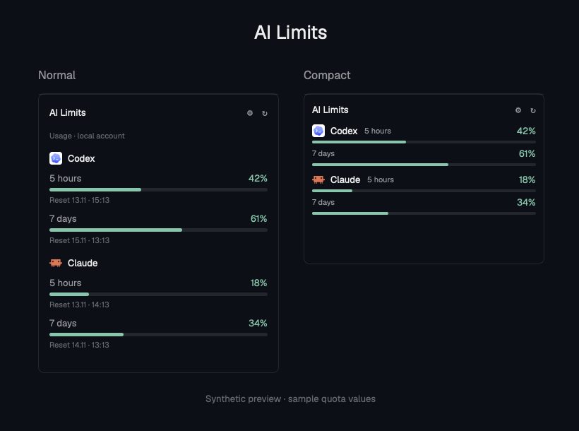

# AI Limits

A sidebar widget showing each installed agent's quota windows, with a compact layout that saves vertical space.



## What you see

AI Limits heading, settings and refresh controls; provider icons/names; quota labels, percentages and 4–5 px bars. Normal mode includes reset dates. Compact mode puts the first quota label beside the provider name and reset dates in tooltips. Errors use short English messages, without an empty bar suggesting zero usage.

## How it behaves

Settings persist Compact view and individual provider visibility. Discovery and refresh repeat every five minutes; manual requests are throttled to once per minute. Disabled providers are skipped. Usage is colored green, amber at 70%, red at 90%; expired resets are dimmed. Unknown integrations remain visible as unavailable. Working/blocked/done/idle terminal status does not affect quota bars.

## Built from

Copy `mods/ai-limits` and `mods/ai-limits-settings`, preserving existing folders. Clone a standard layout and append to its `sidebar-lists` column:

```json
{"id":"ai-limits","type":"block","size":{"px":300},"min":60,"content":{"mod":"ai-limits"}}
```

The exact `ai-limits` ID enables automatic compact sizing. The widget uses `knownAgents`, `shared`/`setShared`, `layout`, `layout.resize`, `exec` and `mod.open`. Python's standard library reads quota-only endpoints or the dedicated agy usage report. Icons come from Herdr's program registry and installed icon assets. No programs.json edits are required.

## Watch out

Read README.md's provider/session requirements and execution behavior before installing. Never combine Gemini CLI and Antigravity allowances. Validate fractions, accept measured zero, skip missing values. Preserve account/provider errors and do not persist tokens or raw reports in widget state. An expired Gemini token is not refreshed by the helper. The current agy probe is POSIX only. This is local-account quota, not a remote pane's quota or token-cost accounting. Keep original normal block sizes per layout.

## Done when

Both native mod checks pass; settings contain installed agents, compact mode shrinks and restores the block, hidden providers are not queried, normal and compact views show the same percentages. Parser tests pass with invalid, missing and exhausted quotas. Verify live numeric data separately for each signed-in provider; unavailable sessions must produce a readable error.
