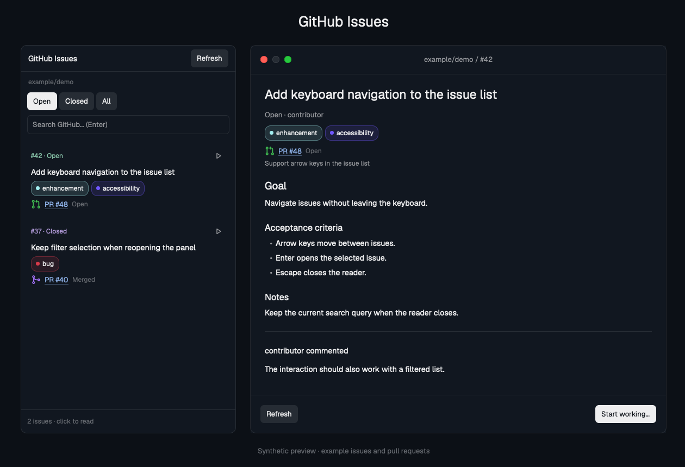
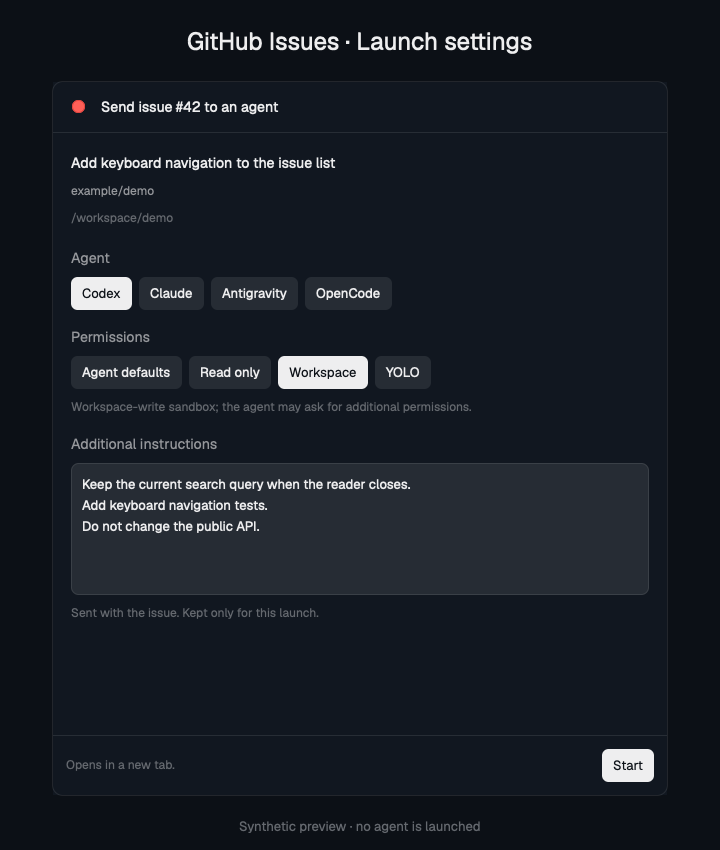
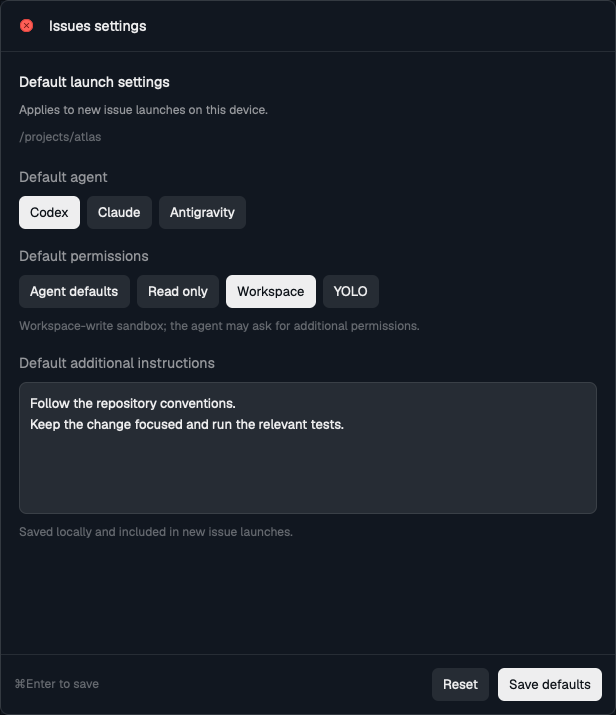

# GitHub Issues

Native issue browser beside Files and Changes. Supports colored labels, linked PRs with GitHub state icons, a Markdown reader with comments, maximize/restore, and a quick agent launcher on each row.



Requires Herdr App 0.1.15, `gh` authenticated with access to the repository, and at least one installed agent for handoff. In remote spaces, `gh` and agent discovery run on that machine. The active terminal must be inside a GitHub repository.

From the repository root:

```sh
python3 install.py github-issues --layout my-issues
python3 install.py github-issues --layout my-issues --apply
```

The two mods are `github-issues` and `tabs-github-issues`. Installation clones a standard layout; custom tab bars require the small manual merge described in [RECIPE.md](RECIPE.md).

Search uses GitHub search syntax and submits on Enter. Clearing the field immediately removes the applied search; the active search is shown below the field with a Clear action. State filters apply the text currently visible in the field. Open/Closed/All filters and More load pages of 50 issues. The list refreshes every minute. Linked PRs include timeline references as well as explicit connections, so a reference is not necessarily a closing PR. The reader's green macOS-style button maximizes/restores; minimize is disabled.

The triangle on a row and **Start working…** in the reader open the same launch settings. Choose an agent, select permissions, optionally add a multiline prompt in **Additional instructions**, then click **Start** or press **⌘Enter**. Enter adds a new line in the prompt. The issue and your instructions open in a new tab pinned to the original repository/space. Selecting an agent or permission mode does not start work.



| Agent | Permission presets |
|---|---|
| Codex | Agent defaults, Read only, Workspace, YOLO |
| Claude | Agent defaults, Ask, Accept edits, Plan, YOLO |
| Antigravity (`agy`) | Agent defaults, Accept edits, Plan, YOLO |
| Other agents / wrappers | Agent defaults; additional instructions remain available |

**Agent defaults** preserves configured launch flags, including any existing bypass flags. Explicit presets replace conflicting permission flags while retaining model and other options. Codex always receives `--no-daemon`; its YOLO mode disables approvals and its sandbox. Claude/Antigravity YOLO skips permission prompts without overriding managed policies or other sandbox settings. A selected YOLO preset labels the action **Start in YOLO**. Use a compatible CLI version on the target machine; custom shell wrappers do not receive guessed flags.

Open the gear beside Refresh to set the **Default agent**, **Default permissions**, and **Default additional instructions**. **Save defaults** (or **⌘Enter**) stores them locally for new launches across repositories; closing cancels edits. **Reset** clears the draft to the first installed agent, Agent defaults, and an empty prompt; save to apply it. Settings never launch an agent.



New launch dialogs inherit these widget defaults. Changes made in a launch dialog apply only to that issue. Switching agents resets permissions to Agent defaults while preserving the prompt. If the saved agent is unavailable on the target machine, the dialog explains the fallback and uses Agent defaults; saved YOLO never transfers to a different agent. Additional instructions are appended literally to the issue task. No global agent configuration is edited. Read only/Plan asks for investigation and a proposed plan. The issue alone does not grant publishing or deployment permission.

Widget defaults are stored by Herdr under `github-issues.launch-defaults.v1` and survive restarts.

Access: runs read-only `gh repo view`, `gh issue list/view`, and `gh api graphql` queries, then Herdr `tab.new` only after agent selection. Issue content is untrusted task material. No credentials are bundled or written. Run `node --test github-issues/tests/*.test.mjs` from the repository root.

A native spinning circle marks an issue while a linked live agent reports `working`. Working issues appear first in the loaded list; relative order within working and other issues is preserved.
The link comes from the launcher's original task URL (host, repository and issue),
including existing sessions and their child terminals; tab renames and worktrees do
not affect it. Idle, blocked, done and exited agents do not keep the circle spinning.
Click the spinner to focus the working agent and highlight it in Agents; working child agents are supported. The click rechecks live status, so a finished agent is not selected. Herdr updates this from live terminal state, without polling GitHub or changing labels.
Agents started outside this launch flow are not inferred from tab names or mentioned links.
