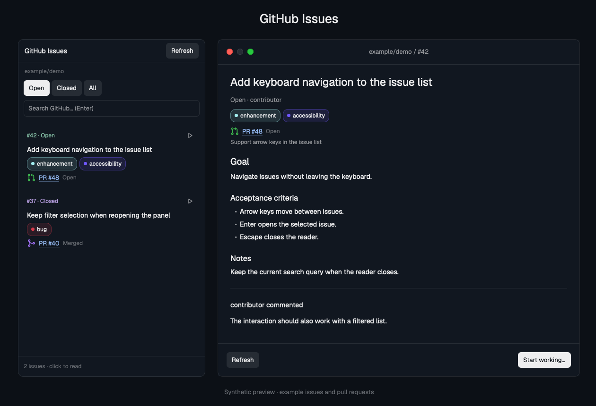

# GitHub Issues

A native issue browser in the right-hand panel, beside Files and Changes, with a readable issue window and one-click access to an agent picker.



## What you see

A roughly 368 px panel contains the heading, repository name, Open/Closed/All filters, search, issue rows and a More footer. Rows show number/state, title, colored GitHub labels, linked PRs, and a small triangle launcher. PR icons distinguish open (green), merged (purple), closed (red) and draft (gray). The reader opens at 960 × 780 with macOS-style window controls, title, metadata, labels, PRs, scrollable Markdown and comments, Refresh and Start working.

## How it behaves

Changing terminal repository discards stale responses. Enter submits search; list refresh is every 60 seconds, 50 issues per page. Clicking a row reads the issue. The green reader control toggles full-window size and preserves loaded content. Red closes; gray minimize is intentionally unavailable. The triangle and the reader’s Start working button open a 560 × 650 launch settings dialog. It contains agent selection, agent-specific permission presets, a 120 px multiline Additional instructions field and a separate Start button. Selecting an agent does not launch it; Start opens one tab pinned to the source space and directory. YOLO changes the action label to Start in YOLO. Switching agents resets permissions; extra instructions remain in the current dialog. New dialogs start with Agent defaults and an empty prompt. Closing the source space prevents launch. Agent working/blocked/done/idle states are handled by Herdr's Agents panel, not duplicated here.

## Built from

Copy `mods/github-issues` and `mods/tabs-github-issues` into the App home, without overwriting existing names. Clone the target layout with `herdr-app do layout.clone '{"name":"main","as":"my-issues"}'`. In that clone, change the `tabs` block's `content.mod` from `tabs` to `tabs-github-issues`. Append this child to the `panel-body` stack:

```json
{"id":"github-issues","type":"block","content":{"mod":"github-issues"}}
```

Keep the existing `panel` and `panel-body` IDs: the tab mod controls them. For a custom tab bar, merge the GitHub panel entry from `tabs-github-issues/main.js` instead of replacing your customizations.

The panel uses `spaces`, `panes`, `focused`, `exec`, `knownAgents`, overlays, `tab.new`, native InputState/TextareaState inputs and Markdown. `gh` fetches issue data and paginated GraphQL timelines in batches of 20. The tab uses the GitHub Octocat logo; it and the PR artwork are Primer Octicons (included MIT license); window and launch artwork is included. The tab clone uses Herdr's installed workspace-chrome, files, changes, pane and new-menu assets.

## Watch out

Authenticate `gh` on the repository's machine. GitHub Enterprise uses the repository host for GraphQL. Unavailable issue data and PR lookup failures are separate errors. Do not turn missing PR data into a claim that no PR exists. Referenced PRs may belong to another repository. Pass task/argv as structured values, never a shell string. Permission presets must remove conflicting CLI flags, preserve model settings and insert options before `--`. Unknown agents, wrappers and noninteractive commands retain only Agent defaults. Keep permissions and additional prompts local to each launch dialog. Keep Codex's Core terminal context with `--no-daemon`.

## Done when

Native checks pass for both mods. The tab appears beside Files/Changes; a real repository lists issues, tags and linked PRs. The reader renders Markdown/comments and restores after maximize. The launcher lists installed agents, exposes matching permissions and accepts multiline extra instructions. Tests verify conflicting flag replacement, prompt delivery, reset on agent changes, pinned source context, double-submit prevention, stale-response rejection, literal search and PR pagination without starting an agent.
